## Agenda

1. Understanding Data through Visuals
2. Model Building and Comparison
3. Errors and Challenges Faced

# 1. Understanding Data through Visuals

## Age
:::: {.columns}

::: {.column width="50%"}

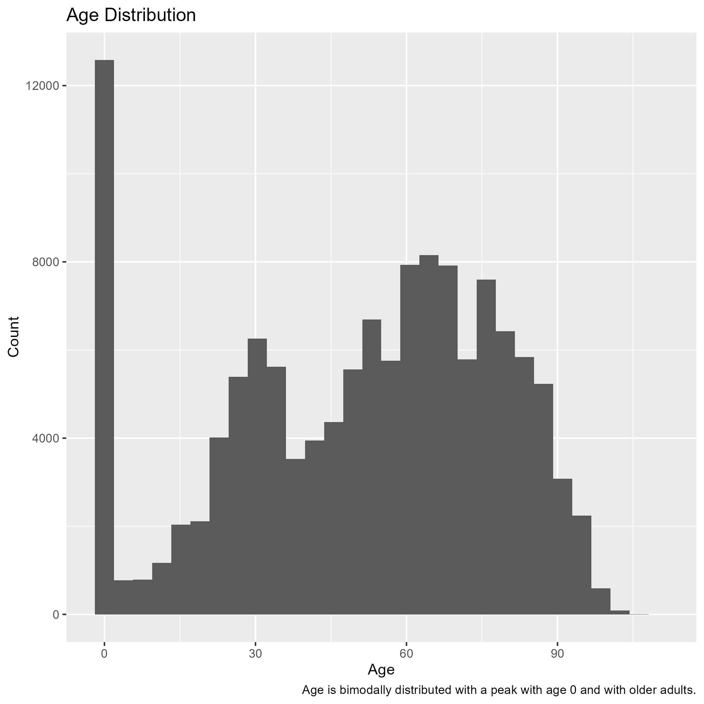

:::

::: {.column width="50%"}
* Age is bimodally distributed
* Peaks at newborn (age = 0) and older adults

:::

::::

## Gender

:::: {.columns}

::: {.column width="50%"}
* There are more females in the dataset than males.

:::

::: {.column width="50%"}

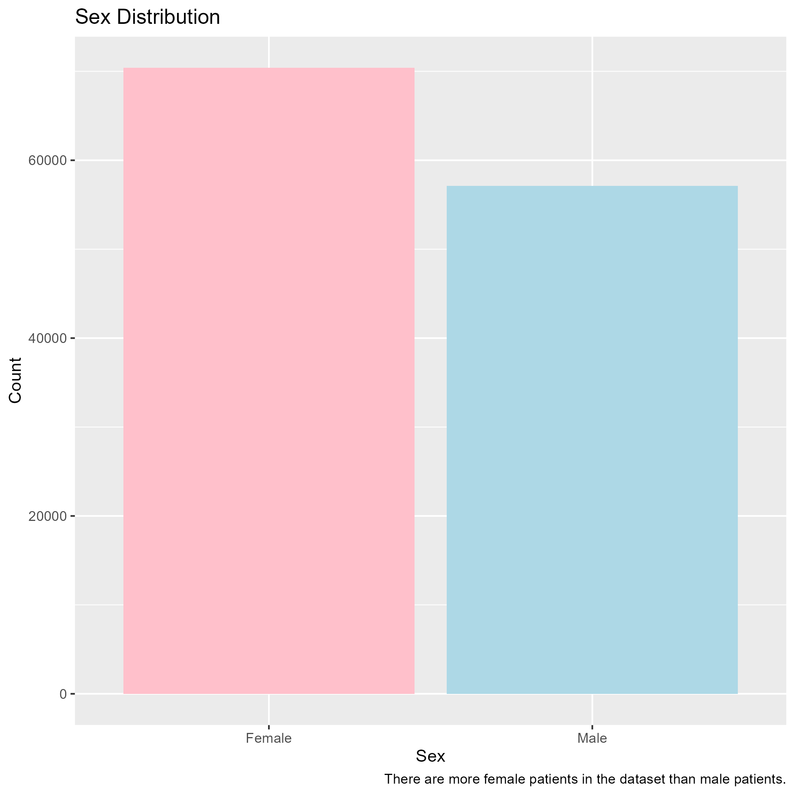
:::

::::

## Cost Distribution

:::: {.columns}

::: {.column width="50%"}

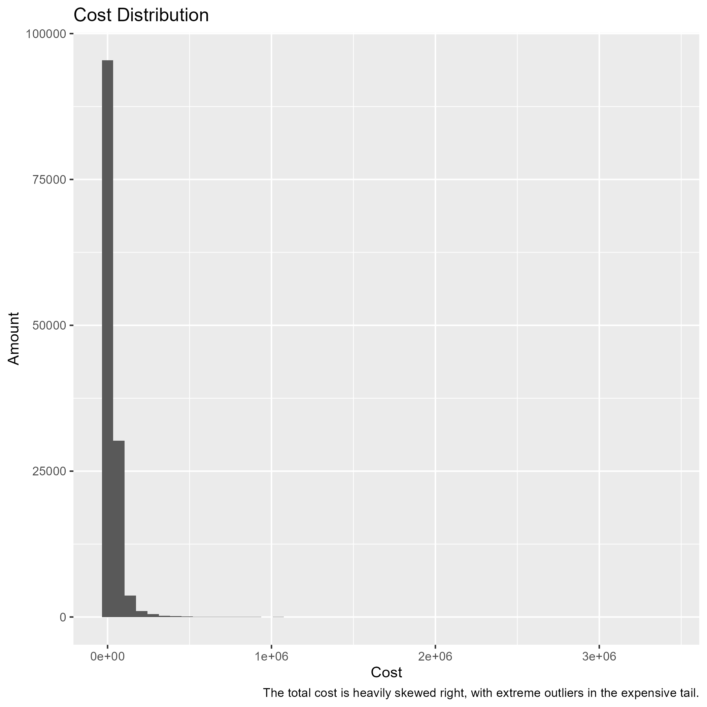

:::

::: {.column width="50%"}
* Cost is heavily skewed right
* Extreme outliers in the expensive tail

:::

::::

## Cost by Gender

:::: {.columns}

::: {.column width="50%"}
* There are extreme outliers in both male and female cost distributions
* The most extreme cost outlier is in the female patients at over $3,000,000

:::

::: {.column width="50%"}

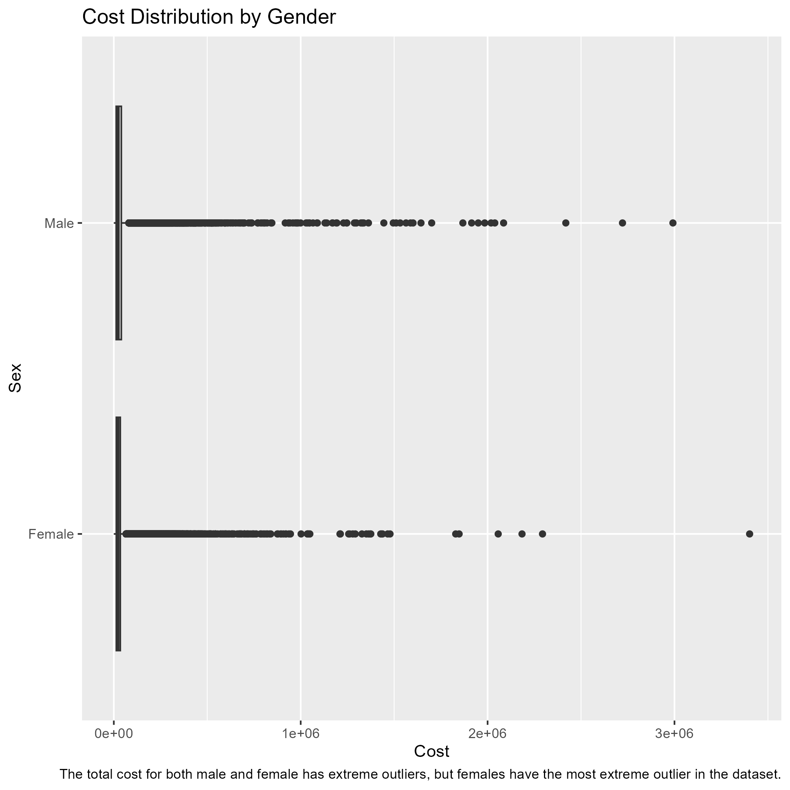
:::

::::

## Age vs. Cost

:::: {.columns}

::: {.column width="50%"}

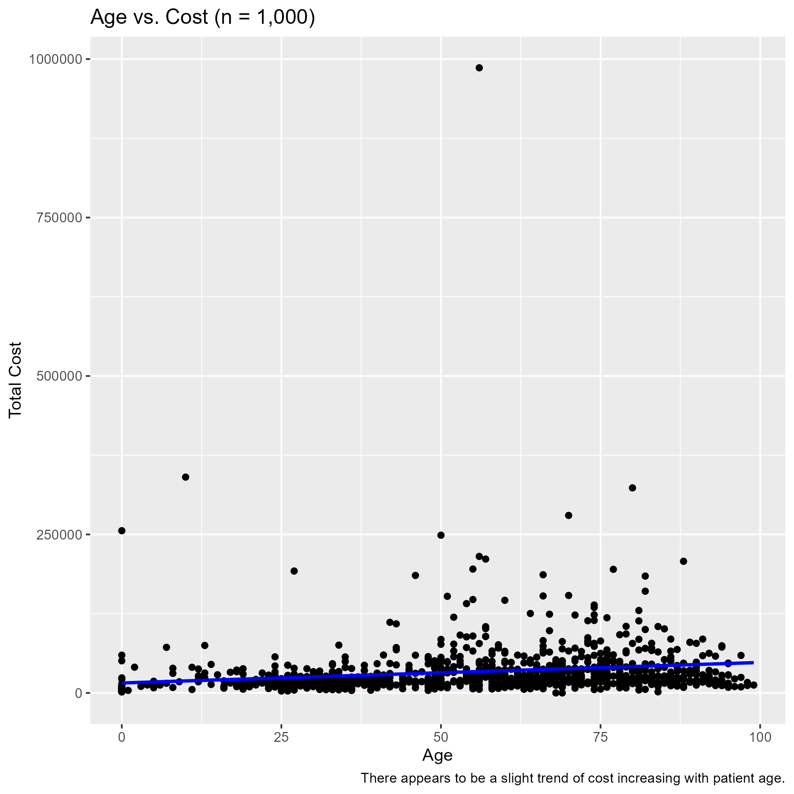

:::

::: {.column width="50%"}
* There is a slight increase in cost as patient age increases.

:::

::::

## Cost by Race/Ethnicity
:::: {.columns}

::: {.column width="50%"}
* There are differences in cost by race
* White patients see the most extreme costs

:::

::: {.column width="50%"}

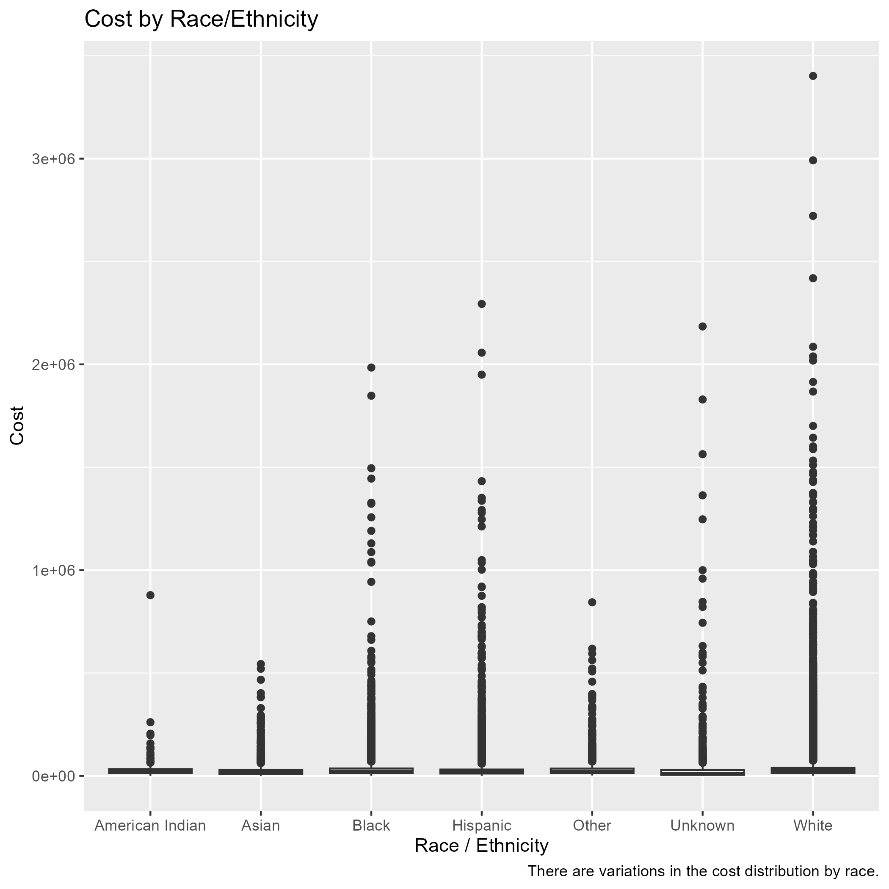
:::

::::

## Length of Stay Distribution

:::: {.columns}

::: {.column width="50%"}
* Heavily skewed right
* Most extreme value: 528 days

:::

::: {.column width="50%"}

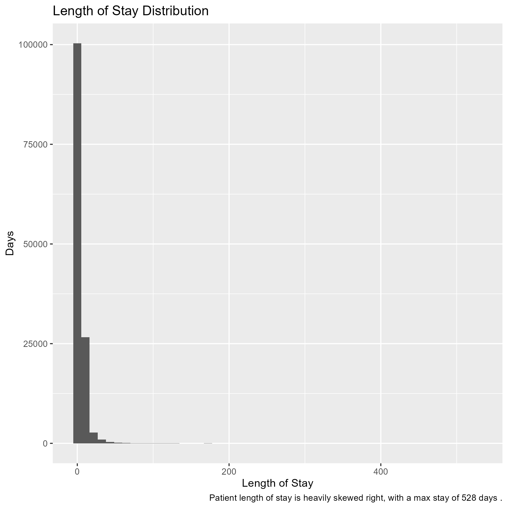
:::

::::

## Monthly Admissions by Race/Ethnicity
:::: {.columns}

::: {.column width="50%"}
* After White patients, Hispanic and Black patients are the next highest percentage of monthly admissions

:::

::: {.column width="50%"}

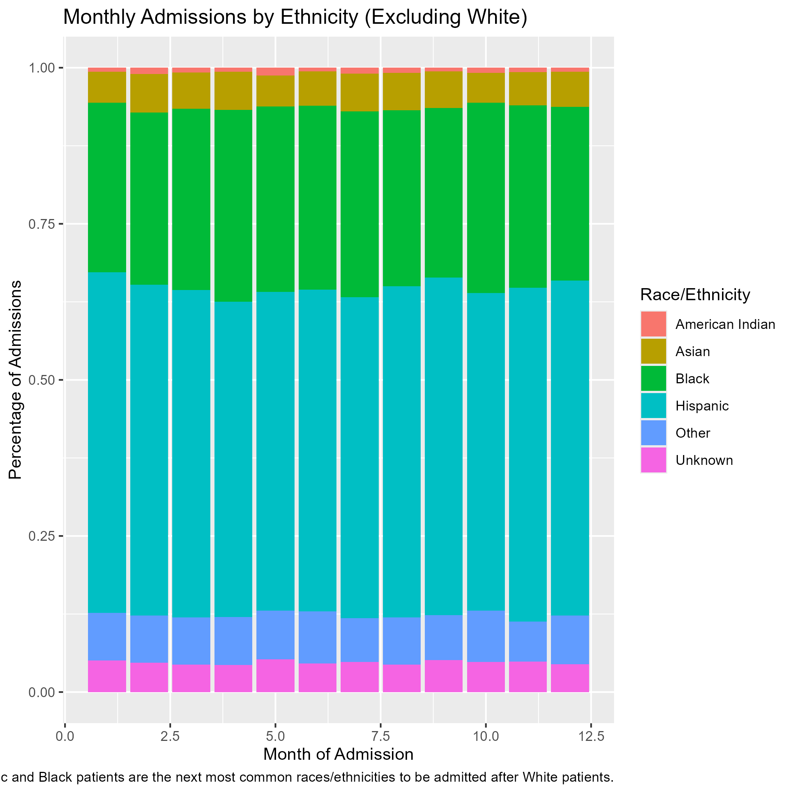
:::

::::

## Average Monthly Cost

:::: {.columns}

::: {.column width="50%"}
* August has the highest average cost
* Drastic fluctuations month to month

:::

::: {.column width="50%"}

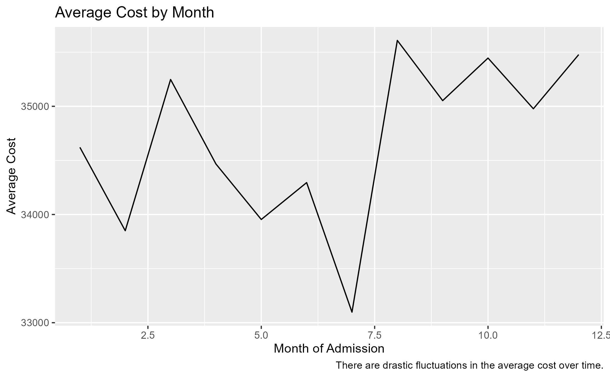
:::

::::

## Average Monthly Cost by Provider
:::: {.columns}

::: {.column width="50%"}
* Bradley consistently has the highest average monthly cost every month
* Most of the other providers are competitive with one another

:::

::: {.column width="50%"}

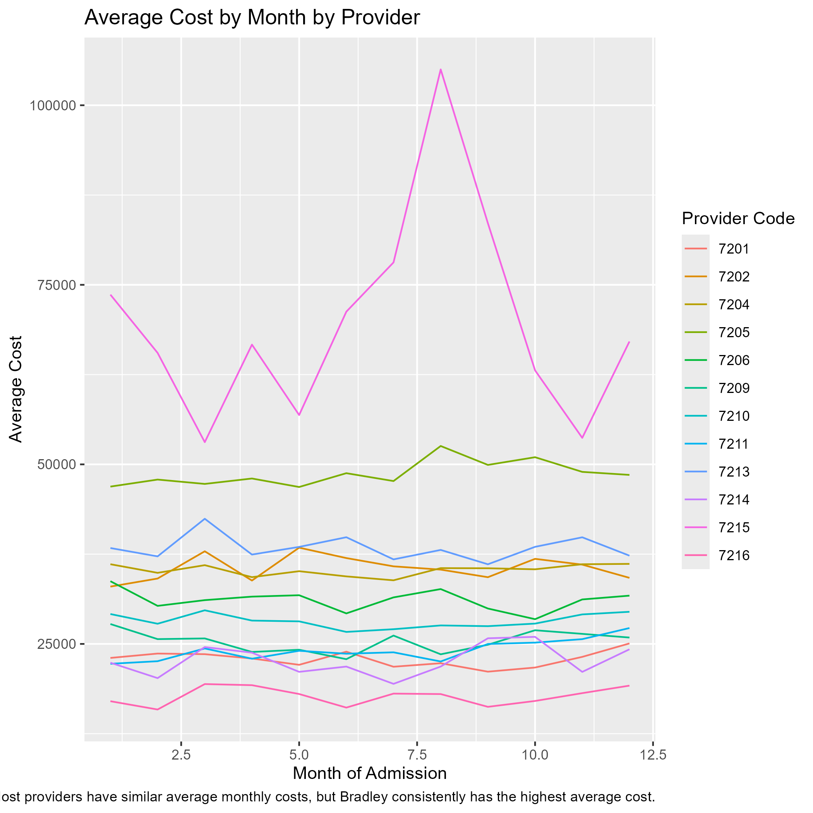
:::

::::

## Monthly Admissions over Time

:::: {.columns}

::: {.column width="50%"}

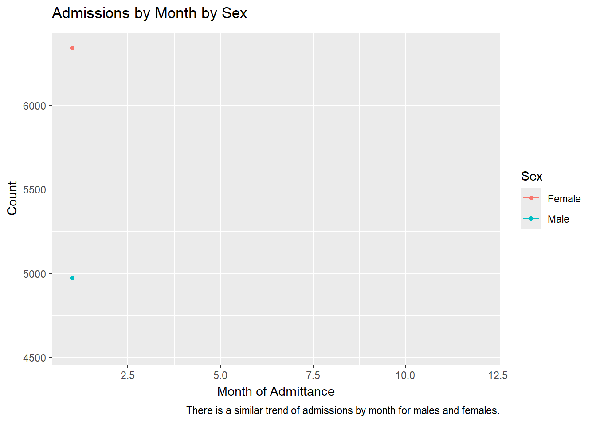

:::

::: {.column width="50%"}
* Since there are more females, there are naturally more female admissions
* Males and females follow similar trends over time.

:::

::::

# 2. Model Building and Comparison

## Models Ran and Evaluated
* **Random Forest:** Combines predictions of multiple trees to create a single, highly accurate, tree
* **K-nearest Neighbors:** Classifies points based on distance of `k` neighbors

## Model Comparison

:::: {.columns}

::: {.column width="80%"}

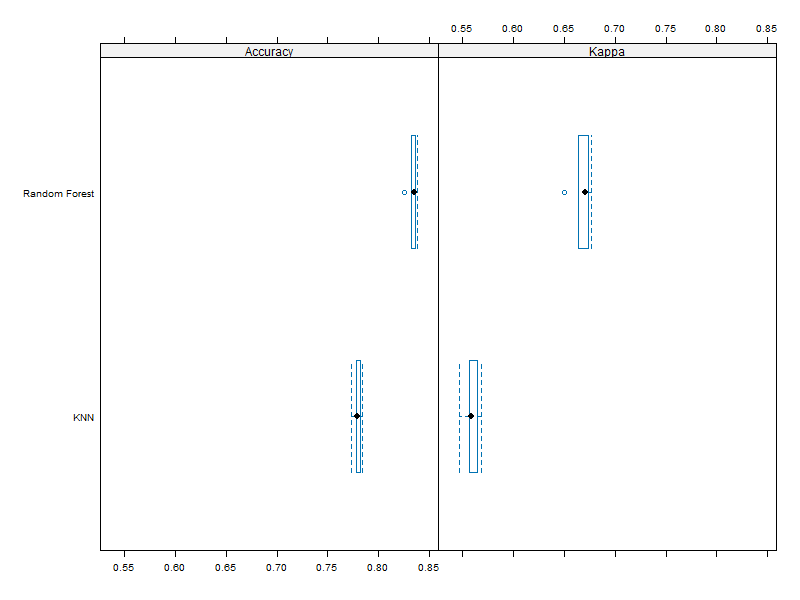

:::

::: {.column width="20%"}
Random forest has higher testing accuracy, so move forward with that model.

:::

::::

## Random Forest Testing Accuracy
* Selected Model: Random Forest
* Testing Accuracy: 83.34248%

## Modeling on `moa`
:::: {.columns}

::: {.column width="80%"}

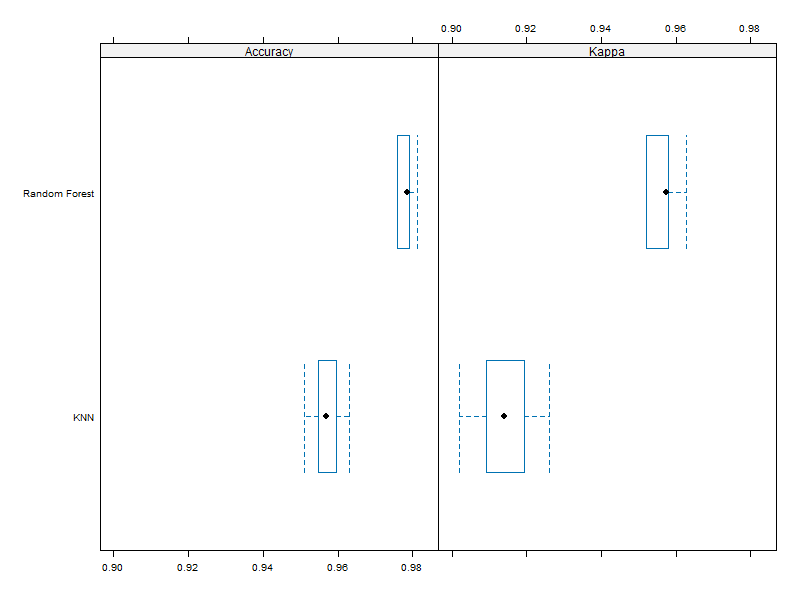

:::

::: {.column width="20%"}
::: {style="font-size: 0.55em;"}
* Target: moa between 1-6 then "Early_Year" else "Late_Year"
* Same input variables
* Future challenge: is there too high of a correlation between an input variable and target variable?
  * Testing Accuracy of Random Forest: 97.59235%
  
:::

:::

::::

# 3. Errors and Challenges Faced

## Lessons Learned
* **Challenge:** Large dataset with over 100,000+ made running models time consuming
  * Solution: Use a sample of the training records for training the Random Forest and KNN models to save time but still capture underlying patterns.
* **Challenge:** A large dataset means it is more time consuming to do things manually (ex: set each individual `character` column as a `factor`)
  * Solution: Seek out/learn more streamlined code to convert data types all at once
  
# Thank You!